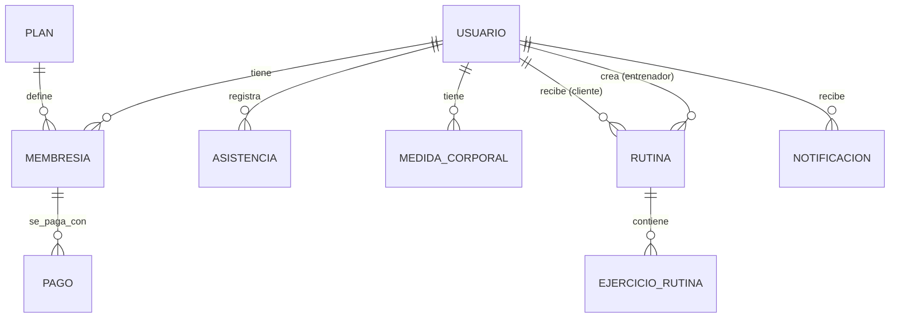

# Modelo de datos

Base de datos: **PostgreSQL**. Todas las tablas tienen `id` (entero autoincremental) y `creado_en` (fecha y hora de creación).

## Diagrama entidad-relación

## Tablas

### usuario
| Campo | Tipo | Notas |
|---|---|---|
| nombre | texto | |
| email | texto, único | se usa para iniciar sesión |
| password_hash | texto | contraseña cifrada con argon2 |
| rol | `admin` · `entrenador` · `cliente` | |
| documento | texto, único, opcional | cédula o documento de identidad |
| telefono | texto, opcional | |
| fecha_nacimiento | fecha, opcional | |
| direccion | texto, opcional | dirección de residencia |
| contacto_emergencia_nombre | texto, opcional | persona a quien avisar en un accidente |
| contacto_emergencia_telefono | texto, opcional | |
| codigo | texto, único | solo clientes, ej. `GP-000123`; es lo que contiene el QR |
| entrenador_id | → usuario, opcional | entrenador asignado al cliente |
| activo | booleano | un usuario inactivo no puede iniciar sesión ni hacer check-in |

### plan
| Campo | Tipo | Notas |
|---|---|---|
| nombre | texto, único | Mensual, Trimestral, Anual |
| duracion_dias | entero | 30, 90, 365 |
| precio | entero | pesos colombianos **sin decimales** (90000 = $90.000) |

> Son **tres planes fijos** que carga la migración (decisión D18). No hay campo `activo`: no se crean ni se desactivan planes; el administrador solo cambia el precio. Cada pago guarda su propio monto, así que un cambio de precio no altera pagos anteriores.

### membresia
Se genera sola a partir de los pagos aprobados (RN2); no se edita a mano.
| Campo | Tipo | Notas |
|---|---|---|
| usuario_id | → usuario | cliente |
| plan_id | → plan | |
| pago_id | → pago, único | el pago que la originó (uno a uno) |
| fecha_inicio | fecha | inclusiva |
| fecha_fin | fecha | inclusiva: inicio + duración − 1 día |

### pago
Nunca se borra: un error se corrige anulándolo.
| Campo | Tipo | Notas |
|---|---|---|
| usuario_id | → usuario | cliente que recibe la membresía |
| plan_id | → plan | |
| monto | entero | pesos; copia del precio del plan al momento del pago (RN16) |
| metodo | `efectivo` · `transferencia` · `pasarela` | |
| estado | `pendiente` · `aprobado` · `rechazado` · `anulado` | los manuales nacen aprobados |
| referencia | texto, opcional | ej. número de transferencia |
| fecha | fecha | día (Colombia) en que se creó |
| creado_en / aprobado_en | fecha y hora (UTC) | de `aprobado_en` sale el inicio de la membresía |
| registrado_por_id | → usuario | administrador (o cliente en la pasarela) |
| anulado_en / anulado_por_id / motivo_anulacion | opcionales | se llenan al anular (RN2b) |

### asistencia
| Campo | Tipo | Notas |
|---|---|---|
| usuario_id | → usuario | cliente |
| fecha_hora | fecha y hora | momento de entrada |
| registrado_por | → usuario | administrador en recepción |

### medida_corporal
| Campo | Tipo | Notas |
|---|---|---|
| usuario_id | → usuario | cliente |
| fecha | fecha | |
| peso_kg | decimal | |
| estatura_cm | decimal | |
| grasa_pct | decimal, opcional | |
| registrado_por | → usuario | entrenador |

### rutina
| Campo | Tipo | Notas |
|---|---|---|
| cliente_id | → usuario | |
| entrenador_id | → usuario | |
| nombre | texto | ej. "Fuerza – principiante" |
| objetivo | texto, opcional | |
| fecha_inicio | fecha | |
| activa | booleano | un cliente tiene **una sola** rutina activa |

### ejercicio_rutina
| Campo | Tipo | Notas |
|---|---|---|
| rutina_id | → rutina | |
| dia | `lunes` … `domingo` | |
| nombre | texto | ej. "Sentadilla" |
| series | entero | |
| repeticiones | texto | texto para permitir "10-12" |
| descanso_seg | entero, opcional | |
| notas | texto, opcional | |
| orden | entero | orden dentro del día |

### notificacion
Aviso dentro del sistema para una persona. Único por (usuario, tipo, referencia): así la tarea diaria no repite avisos.
| Campo | Tipo | Notas |
|---|---|---|
| usuario_id | → usuario | a quién se le avisa |
| tipo | `por_vencer` · `vence_hoy` · `resumen_admin` (el Sprint 2 agregará `recordatorio_asistencia`) | |
| titulo / mensaje | texto | |
| referencia | fecha | vencimiento que origina el aviso (clientes) o el día del resumen (administrador) |
| leida | sí/no | |
| creado_en | fecha y hora (UTC) | |

## Datos que NO se guardan (se calculan)
- **Estado de la membresía** (al día, por vencer, en mora)
- **Racha** y **% de cumplimiento** de asistencia
- **Indicadores del dashboard**

Se calculan al consultarlos para que nunca queden desactualizados. Las reglas están en `reglas-negocio.md`.
